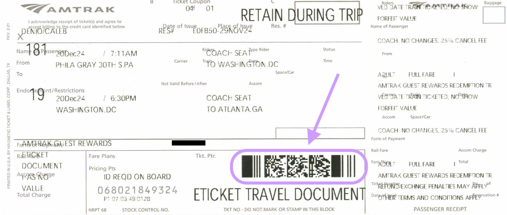
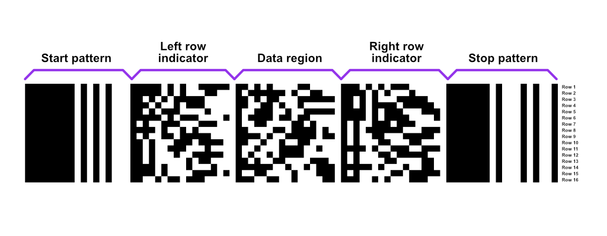
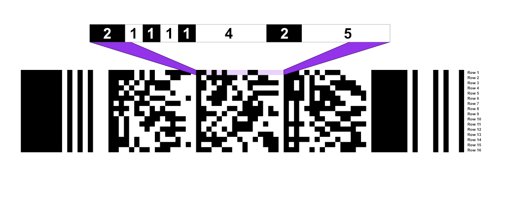
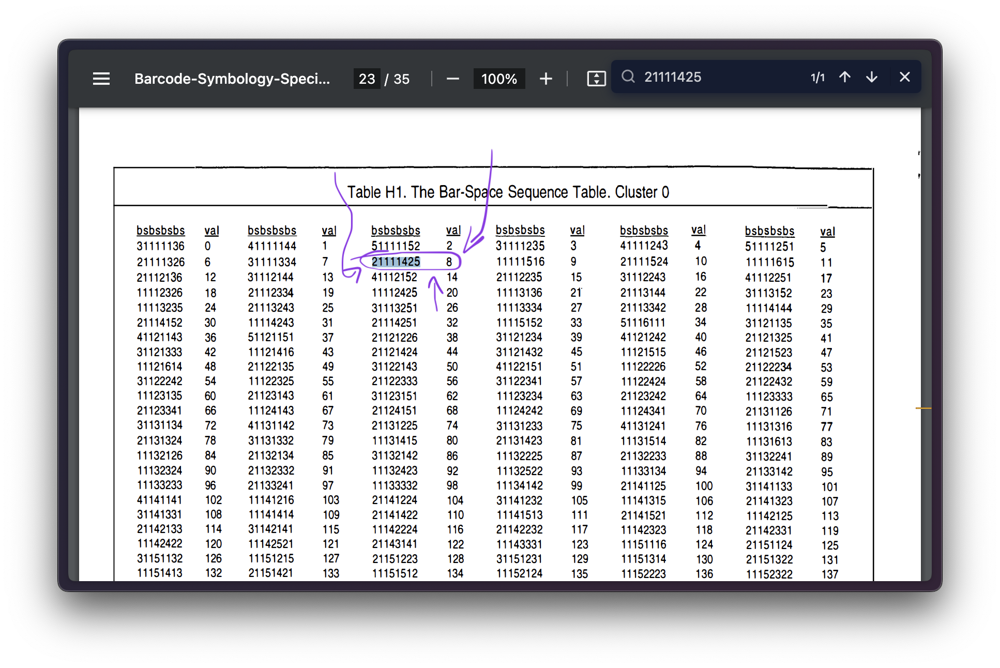
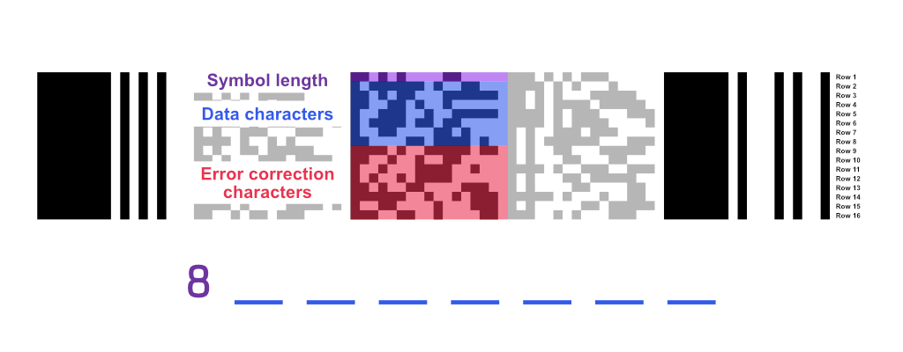

Fairly recently, I found myself on a multi-day train journey from Boston to Atlanta for the Christmas holiday. While I've generally been a fan of mobile ticketing, this time I decided to print off a paper ticket from an [Amtrak kiosk](https://media.amtrak.com/2021/10/amtrak-debuts-new-ticket-kiosks-with-national-rollout/) at Philadelphia 30th Street Station. Consider it a small step towards reducing my smartphone reliance.

Right off the bat, this looks a little different from an Amtrak mobile ticket. Instead of a QR code, we've got a [PDF417](https://en.wikipedia.org/wiki/PDF417) barcode— the same type used on US driver's licenses and paper airline tickets. It's a pretty small one, so there's probably not a ton of data in here. But hey, at least this makes it easier to decode by hand!

## What's in a PDF417 barcode?

PDF417 codes consist of stacked "rows" of data. Each row contains:

- A static **start pattern**
- A **"left row indicator"**, which has some metadata about the barcode itself
- Some **"data characters"** (our Amtrak ticket only has one per row, but bigger barcodes can have up to 30)
- A **"right row indicator"**, which has some additional metadata
- A static **stop pattern**

We'll be focusing entirely on the data region for now.

## Reading the first data character

PDF417 "characters" are made up of bars and spaces in an alternating pattern. Each bar/space is a certain number of "units" wide. Each character is 17 units wide _(thus the "17" in "PDF417")_, so you can think of a "unit" as "1/17th the width of a character".

Here's an example of the first character with bar/space lengths filled in:

On page 22 of [the PDF417 specification](https://www.expresscorp.com/wp-content/uploads/2023/02/USS-PDF-417.pdf), we'll find 3 lookup tables (or "clusters") that we can use to translate these bar/space lengths into a value from 0 to 928.

We select which cluster to pull from based on the row we're decoding:

- Row 1: Cluster 0
- Row 2: Cluster 3
- Row 3: Cluster 6
- Row 4: Cluster 0
- Row 5: Cluster 3
- Row 6: Cluster 6
- ...etc

Since we're on row 1, let's search the "cluster 0" table for "21111425", and voila, an 8!

The first character is special: it tells us how many characters

