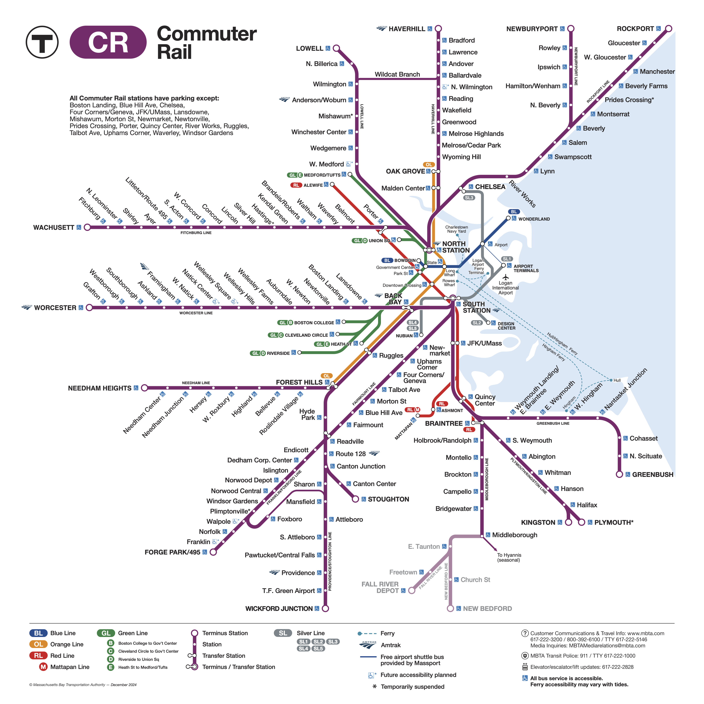
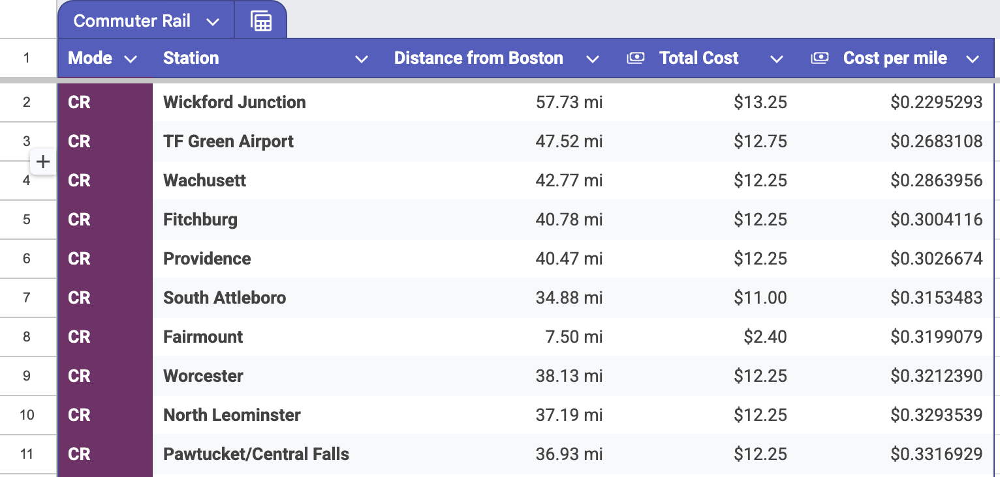

Okay. Hypothetical scenario time. You need to get **as far away from Boston as possible**. Maybe there are zombies, too many bad drivers, a vengeful ex, or you just need an adventure.

However, as a cost-conscious individual, you don't want to spend hundreds on a plane or Amtrak ticket. You need to balance distance with cost, so the question you really should be asking is, _"what's the **best value** route out of Boston?"_

## First, Some Ground Rules:

- I'm using **cost per mile** (total cost / milage) as a metric to rank transit options
- I'm measuring milage, as the crow flies, from South Station (the bus/rail hub in central Boston)
- In order to be eligible, a transit mode must:
  - Not require reservations in advance (online ticket sales are fair game as long as you don't need to reserve a specific departure time)
  - Offer a fixed cost between stations (so no Amtrak or Greyhound)
- Finally, I'm excluding the MBTA's [$10 Commuter Rail Weekend Pass](https://www.mbta.com/fares/commuter-rail-weekends) since it's inconvenient for my results.

## The Commuter Rail

The MBTA's Commuter Rail is an immediate first contender. It's fairly affordable (as a commuter service), but goes farther into the hinterlands of Massachusetts than, say, the subway does.



So I started a new ✨spreadsheet✨ and calculated the 'cost per mile' from South Station to every Commuter Rail station.

> Yes, many CR lines leave North Station— I ignored this simply because I didn't feel like taking it into account.



Okay, [Wickford Junction](https://www.mbta.com/stops/place-NEC-1659) is ranked 1st at ~23¢ per mile. Not a super interesting result, since Wickford Junction is just... the farthest south you can travel on the Commuter Rail network. But what if we looked at some other transit modes?

## The Subway

<!-- <iframe width="600" height="371" seamless frameborder="0" scrolling="no" src="https://docs.google.com/spreadsheets/d/e/2PACX-1vRY4GA4yYTnlnVS1m8WhLpCRpIi9FM2yemkH1QfqiEIFHngXdHM-92yl39fg1BkuiR82W8lz5P_-U7n/pubchart?oid=418181286&amp;format=interactive"></iframe> -->

<!-- <iframe width="600" height="371" src="https://docs.google.com/spreadsheets/d/e/2PACX-1vRY4GA4yYTnlnVS1m8WhLpCRpIi9FM2yemkH1QfqiEIFHngXdHM-92yl39fg1BkuiR82W8lz5P_-U7n/pubhtml?gid=377754937&amp;single=true&amp;widget=true&amp;headers=false"></iframe> -->

<!-- ```ruby
require "json"
require "csv"
require "net/http"

FARES = {
  "CR-zone-1A" => 2.40,
  "CR-zone-1"  => 6.50,
  "CR-zone-2"  => 7.00,
  "CR-zone-3"  => 8.00,
  "CR-zone-4"  => 8.75,
  "CR-zone-5"  => 9.75,
  "CR-zone-6"  => 10.50,
  "CR-zone-7"  => 11.00,
  "CR-zone-8"  => 12.25,
  "CR-zone-9"  => 12.75,
  "CR-zone-10" => 13.25,
}
SOUTH_STATION = [42.35141, -71.055417]

def distance(loc1, loc2)
  rad_per_deg = Math::PI/180  # PI / 180
  rkm = 6371                  # Earth radius in kilometers
  rm = rkm * 0.6213711922     # Radius in miles

  dlat_rad = (loc2[0]-loc1[0]) * rad_per_deg  # Delta, converted to rad
  dlon_rad = (loc2[1]-loc1[1]) * rad_per_deg

  lat1_rad, lon1_rad = loc1.map {|i| i * rad_per_deg }
  lat2_rad, lon2_rad = loc2.map {|i| i * rad_per_deg }

  a = Math.sin(dlat_rad/2)**2 + Math.cos(lat1_rad) * Math.cos(lat2_rad) * Math.sin(dlon_rad/2)**2
  c = 2 * Math::atan2(Math::sqrt(a), Math::sqrt(1-a))

  rm * c
end

stations = JSON.parse(Net::HTTP.get(URI("https://api-v3.mbta.com/stops?filter[route_type]=2")))["data"]

result = [["Station", "Distance from Boston (mi)", "Cost"]]

stations.each do |station|
  result << [
    station["attributes"]["name"],
    distance(SOUTH_STATION, [station["attributes"]["latitude"], station["attributes"]["longitude"]]),
    FARES[station.dig("relationships", "zone", "data", "id")],
  ]
end


File.write "result.csv", result.map(&:to_csv).join("")
``` -->
