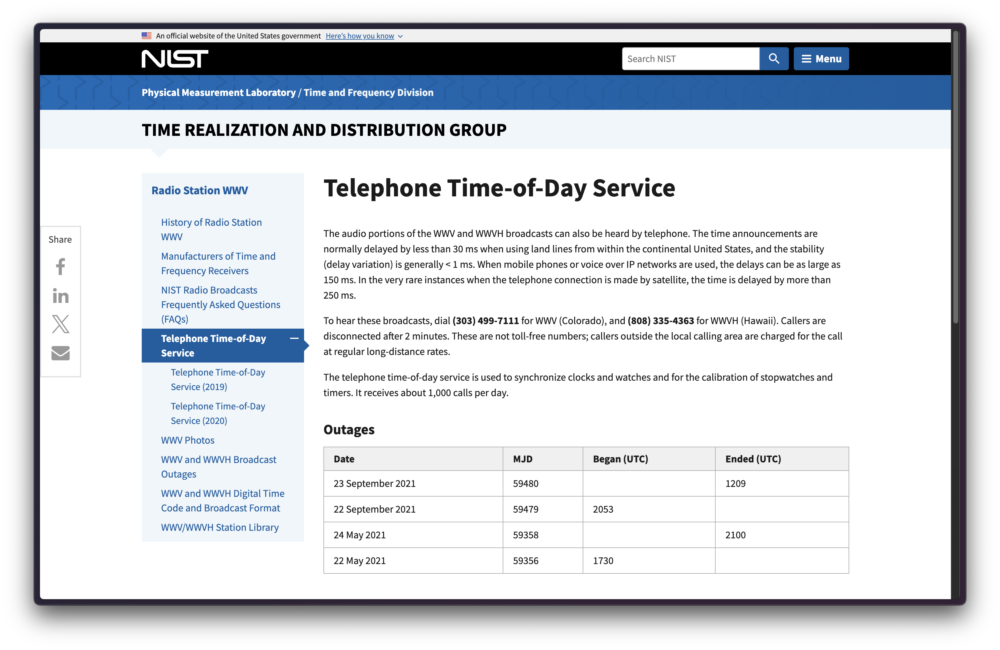

When's the last time you had to manually set a clock? I'm sure it's been a while for many of us, considering we all have precision network-synced clock devices in our pockets 24/7. I certainly take this for granted— how would somebody get an accurate time-of-day before the Internet?

In the US, you can call [(303) 499-7111](tel:+13034997111) to hear NIST's [Telephone Time-of-Day](https://www.nist.gov/pml/time-and-frequency-division/time-distribution/radio-station-wwv/telephone-time-day-service) broadcast count off the minutes and seconds, every minute of every day.

How useful is this today? Not very. But I'm reassured by its continued existence.
